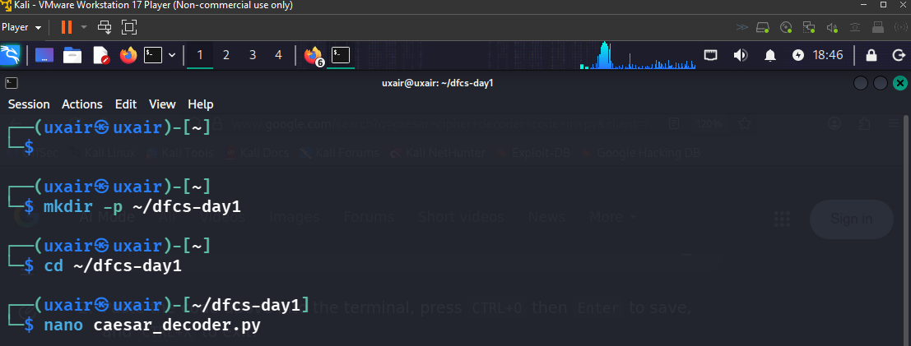
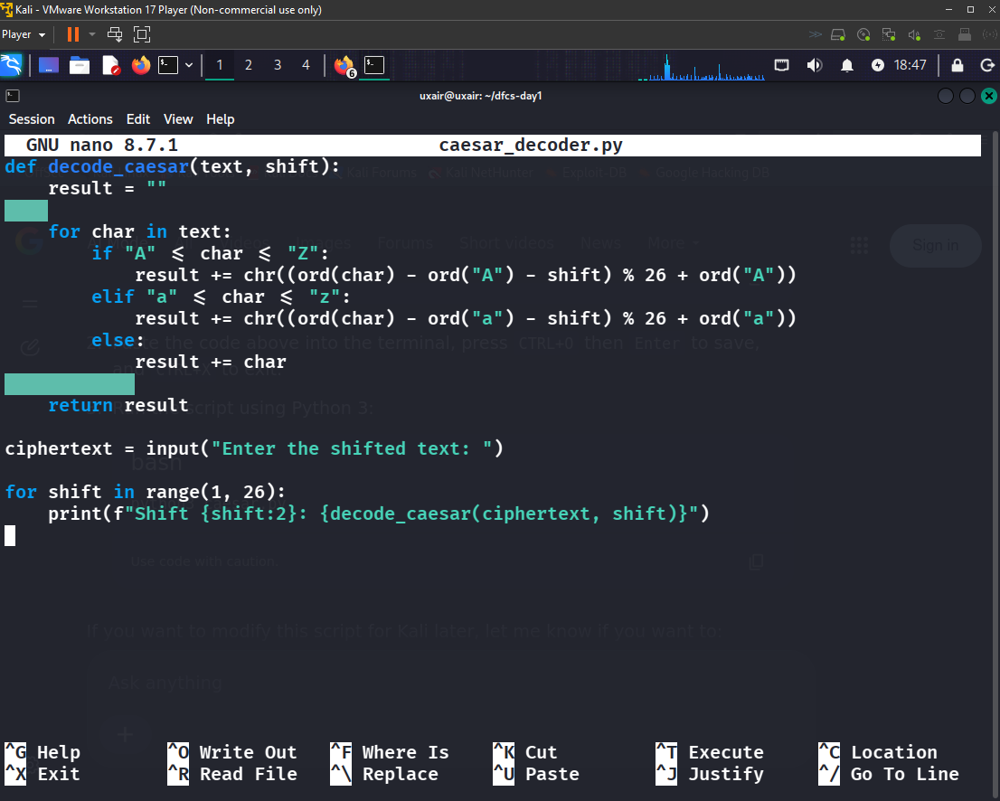
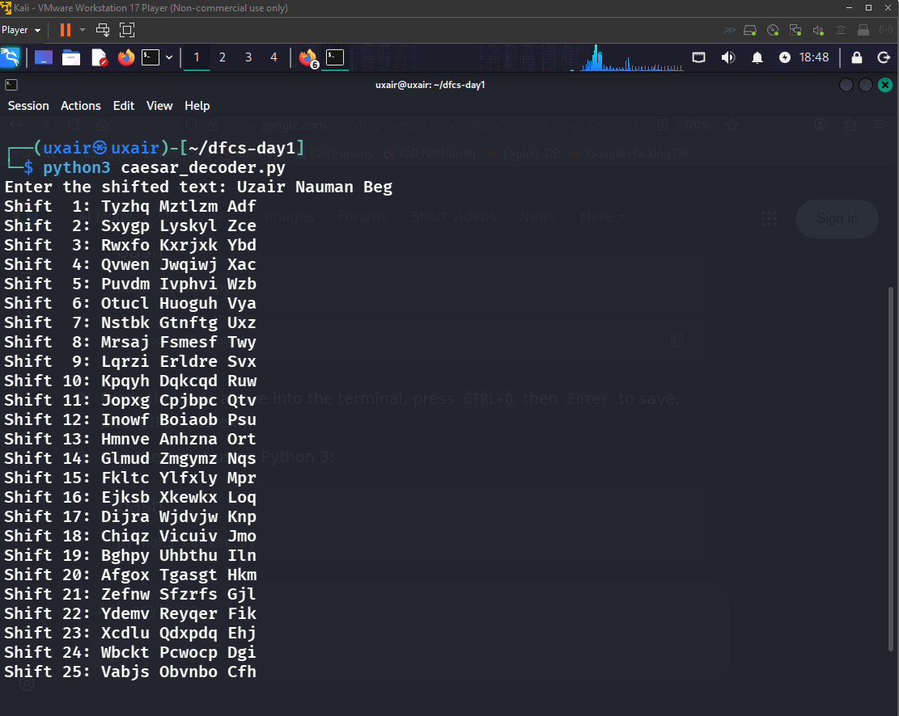
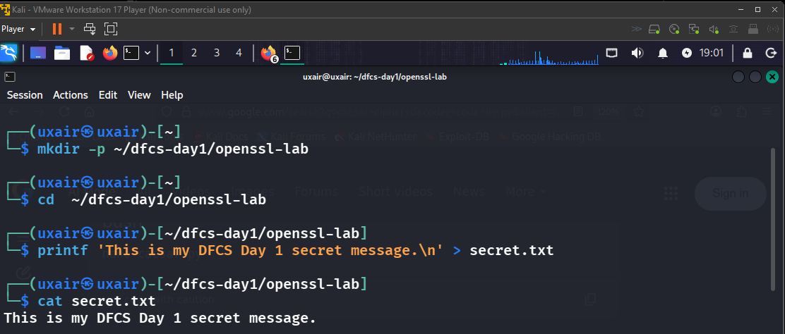
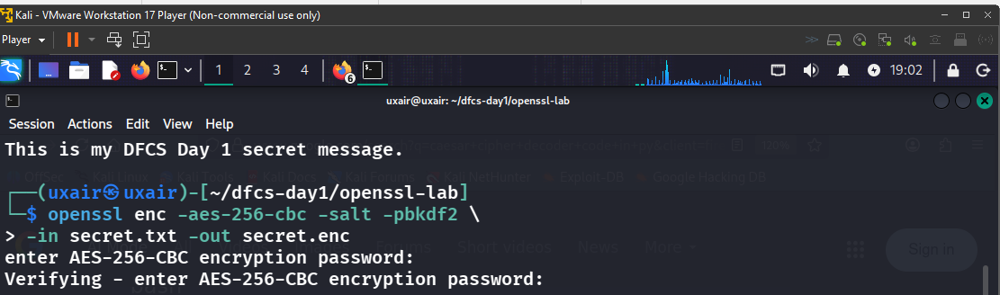
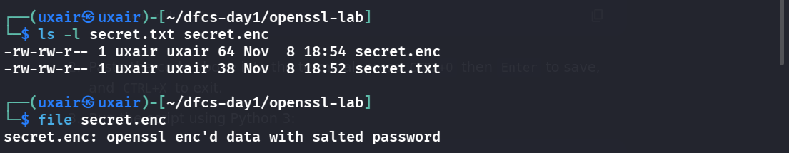
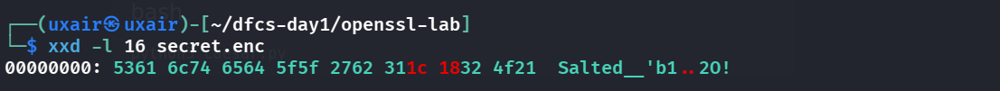
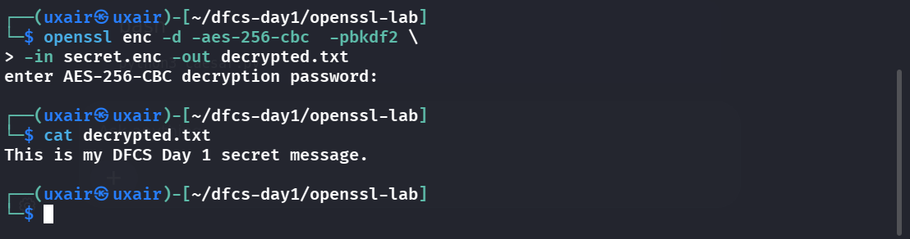

# DFCS Day 1 — Homework Assignment

**Course:** Digital Forensics & Cyber Security  
**Student:** Uzair Nauman Beg  
**ID:** PSEB-2026-008445  
**Section:** Cybersecurity Cohort 2 (Weekend)  
**Date:** 8 November 2026  
**Lab environment:** Kali Linux VM (VMware Workstation 17 Player)

---

## Task A — Malware Types and Real-World Examples

### Which malware type is the greatest danger to a Pakistani SME?

In my assessment, **ransomware** is among the most dangerous threats to a Pakistani small or medium-sized enterprise (SME). An SME often relies on a handful of computers, shared folders, accounting software and customer records. If ransomware encrypts these, daily operations, revenue and customer trust all suffer. The risk grows when backups sit on the same network, systems go unpatched, remote access is poorly secured, or staff cannot recognise phishing. (Supporting example: WannaCry [2], which exploited unpatched Windows machines.)

### Malware table

| Malware type | Definition (own words) | Named example + year | Propagation / entry method | Primary impact | Source |
|---|---|---|---|---|---|
| Virus | Embeds itself in a legitimate file or boot area and spreads whenever the infected host is run or shared. | Brain (1986) | One of the earliest PC viruses; infected floppy boot sectors, so swapping disks carried it between machines. | Displayed a message and proved boot-sector infection could travel between PCs. | [9], [8] |
| Worm | Self-replicating malware that moves between systems on its own, without attaching to another program. | ILOVEYOU (2000) | Email with an enticing subject and a VBS attachment; once opened, it used Outlook to mail copies to the victim's contacts. | Flooded mail systems, damaged or overwrote files, disrupted businesses and agencies. | [1] |
| Trojan | Masquerades as useful software so users run it; does not need to replicate. | Zeus (2007) | Phishing emails, malicious downloads, drive-by compromises. | Harvested online-banking credentials and other data, enabling financial fraud. | [10], [8] |
| Ransomware | Locks users out of data or systems, usually by encrypting files, then demands payment. | WannaCry (2017) | Exploited a vulnerable Windows SMB service via EternalBlue; unpatched machines were exposed. | Encrypted files and crippled organisations worldwide, including parts of the UK NHS. | [2] |
| Spyware | Covertly watches a device or user and gathers information without informed consent. | Pegasus (publicly documented 2016) | Malicious links and exploit chains against targeted phones; later versions used zero-click techniques. | Hidden access to phone data and communications; serious privacy and surveillance risk. | [11], [8] |
| Adware | Pushes unwanted advertising and may alter browser settings or redirect searches for revenue. | Fireball (2017) | Bundled with freeware; installed browser components and configuration changes. | Hijacked homepages and search engines, manipulated traffic, could fetch further malware. | [3] |
| Rootkit | Conceals malicious activity, typically by tampering with low-level OS components or utilities. | Sony BMG XCP rootkit (2005) | Certain music CDs installed copy-protection software on Windows that used rootkit-style hiding. | Concealed files and processes, weakened system security, raised privacy concerns. | [12], [8] |
| Keylogger | Records keystrokes to capture usernames, passwords and messages. | Olympic Vision (2016) | Spear-phishing emails carrying a malicious attachment that installs the keylogger. | Captured keystrokes and credentials, supporting espionage and business-email compromise. | [13], [8] |
| Botnet agent | Infects a device so an operator can control it remotely as part of a larger pool. | Mirai (2016) | Scanned internet-connected IoT devices and tried common or hard-coded default credentials. | Turned routers, cameras and DVRs into a botnet for massive DDoS attacks. | [4], [15] |
| Fileless / living-off-the-land | Runs malicious activity in memory and/or via legitimate tools already on the system. | Astaroth campaign (Microsoft, 2019) | Spear-phishing link → archive with LNK shortcut; abused WMIC, BITSAdmin, Certutil, Regsvr32. | Ran an info-stealing backdoor in memory; siphoned credentials, keystrokes and other data. | [5] |
| Logic bomb | Malicious code that stays dormant until a condition, event or time triggers it. | UBS logic-bomb case (2002) | A former systems administrator planted code that detonated after he left. Public reporting describes the trigger and sabotage, not a spreading mechanism. | Damaged company systems; intended to cause disruption and financial harm. | [14], [7] |
| Bootkit | Infects the boot process or firmware so malicious code runs before the OS loads. | MoonBounce (first seen 2021; reported 2022) | Implant found in UEFI firmware; no general self-spreading mechanism or initial entry vector was identified publicly. | Stealthy, persistent execution beneath the OS; could load further components. | [6] |

**Source note:** Years mark public reporting or a notable incident, not necessarily when the malware was created. For MoonBounce and the UBS logic bomb, the cited summaries do not establish a general self-spreading mechanism. [8] is used for the general malware-category definitions. The DOJ source for UBS [14] is a 2002 indictment, so it describes allegations at that stage; Duronio was later convicted and sentenced. The DOJ page for Mirai [15] confirms IoT devices (cameras, routers, DVRs) and DDoS but does not mention default credentials; that detail comes from [4] and should be re-checked against the original FBI page.

---

## Task B — Selected Practical Exercises

I chose **B3** (Caesar cipher decoder) and **B4** (OpenSSL file encryption and header inspection). Both were done in the Kali VM; screenshots below are from that VM.

## B3 — Caesar Cipher Decoder in Python

### Objective

Write a Python program that takes a Caesar-shifted string and prints all 25 possible non-zero shifts. Because every candidate can be checked instantly, this shows why the Caesar cipher is unsuitable for real security.

### 1. Create the script

```bash
mkdir -p ~/dfcs-day1
cd ~/dfcs-day1
nano caesar_decoder.py
```



The script as entered in nano (also saved in this repo as [`caesar_decoder.py`](caesar_decoder.py)):

```python
#!/usr/bin/env python3

def decode_caesar(text, shift):
    result = ""

    for char in text:
        if "A" <= char <= "Z":
            result += chr((ord(char) - ord("A") - shift) % 26 + ord("A"))
        elif "a" <= char <= "z":
            result += chr((ord(char) - ord("a") - shift) % 26 + ord("a"))
        else:
            result += char

    return result


ciphertext = input("Enter the shifted text: ")

for shift in range(1, 26):
    print(f"Shift {shift:2}: {decode_caesar(ciphertext, shift)}")
```



### 2. Run the program

```bash
python3 caesar_decoder.py
```

I entered a sample string and the program printed every candidate from Shift 1 to Shift 25 instantly:



### 3. Explanation

A Caesar cipher replaces each letter with one a fixed number of positions along the alphabet. Only 25 non-zero shifts exist, so an attacker can try them all in a fraction of a second and pick the line that reads as meaningful text. For example, `KDFNHU` decodes to `HACKER` at shift 3, and that line would stand out among the 25 candidates. (This is a worked illustration, not part of the screenshots.) The Caesar cipher therefore offers no meaningful protection by modern standards.

## B4 — Encrypt a File with OpenSSL and Inspect Its Header

### Objective

Encrypt a text file with AES-256-CBC using OpenSSL, examine the first bytes of the result with `xxd`, and explain the `Salted__` header.

### 1. Create a working directory and a plaintext file

```bash
mkdir -p ~/dfcs-day1/openssl-lab
cd ~/dfcs-day1/openssl-lab
printf 'This is my DFCS Day 1 secret message.\n' > secret.txt
cat secret.txt
```



### 2. Encrypt the file

```bash
openssl enc -aes-256-cbc -salt -pbkdf2 \
  -in secret.txt -out secret.enc
```

OpenSSL prompted for a password and asked me to verify it. I used a temporary lab password, which is not shown anywhere here.

Files from this run are in [`openssl-lab/`](openssl-lab/) (`secret.txt`, `decrypted.txt`). The encrypted file `secret.enc` is documented by Figures 6 and 7 (size, file type and header bytes).



### 3. Inspect the files

```bash
ls -l secret.txt secret.enc
file secret.enc
```



The plaintext is 38 bytes and the encrypted file is 64 bytes. The 26-byte difference comes from a 16-byte header (8-byte `Salted__` marker + 8-byte salt) plus padding: AES works in 16-byte blocks, so 38 plaintext bytes are padded to 48 bytes of ciphertext (16 + 48 = 64). `file` identifies the result as "openssl enc'd data with salted password".

### 4. Inspect the header

```bash
xxd -l 16 secret.enc
```



The first eight bytes, `53 61 6c 74 65 64 5f 5f`, are the ASCII text `Salted__`. The next eight bytes (`27 62 31 1c 18 32 4f 21` in my run) are the random salt.

### 5. What `Salted__` means

`Salted__` is an eight-byte marker the OpenSSL `enc` format writes at the start of the file when a salt is used; the salt follows it. The salt is neither the password nor a secret. Its purpose is to produce a different encryption key each time, even when the same password is reused, because each run uses a different random salt. Since the salt is stored in the file, decryption needs only the correct password.

### 6. Decrypt to verify

```bash
openssl enc -d -aes-256-cbc -pbkdf2 \
  -in secret.enc -out decrypted.txt
cat decrypted.txt
```



The recovered text is identical to the original, confirming encryption and decryption worked.

> **Security note:** AES-256-CBC gives confidentiality but does not authenticate the ciphertext. For real applications, prefer authenticated encryption such as AES-GCM through a well-vetted library or tool.

---

## References

1. U.S. Government Accountability Office — [ILOVEYOU Computer Virus: May 2000](https://www.gao.gov/products/t-aimd-00-181)
2. NHS England Digital — [WannaCry ransomware and SMB vulnerability](https://digital.nhs.uk/cyber-alerts/2017/cc-1411)
3. Check Point Research — [Fireball malware, 2017](https://research.checkpoint.com/2017/fireball-chinese-malware-250-million-infection/)
4. FBI Internet Crime Complaint Center — [IoT devices and the Mirai botnet](https://www.ic3.gov/PSA/2017/PSA171017)
5. Microsoft Security Blog — [Astaroth fileless campaign, 2019](https://www.microsoft.com/en-us/security/blog/2019/07/08/dismantling-a-fileless-campaign-microsoft-defender-atp-next-gen-protection-exposes-astaroth-attack/)
6. Kaspersky — [MoonBounce UEFI firmware bootkit](https://www.kaspersky.com/about/press-releases/more-elusive-and-more-persistent-the-third-known-firmware-bootkit-shows-major-advancement)
7. Malwarebytes — [Logic bombs and documented cases](https://www.malwarebytes.com/logic-bomb)
8. CrowdStrike — [Types of malware and examples](https://www.crowdstrike.com/en-us/cybersecurity-101/malware/types-of-malware/)
9. Wikipedia — [Brain (computer virus)](https://en.wikipedia.org/wiki/Brain_(computer_virus))
10. Wikipedia — [Zeus (malware)](https://en.wikipedia.org/wiki/Zeus_(malware))
11. Wikipedia — [Pegasus (spyware)](https://en.wikipedia.org/wiki/Pegasus_(spyware)) (summarises the 2016 Citizen Lab / Lookout analysis)
12. Wikipedia — [Sony BMG copy protection rootkit scandal](https://en.wikipedia.org/wiki/Sony_BMG_copy_protection_rootkit_scandal)
13. Trend Micro — [Olympic Vision: Business Email Compromise Campaign Targets Companies in US, Middle East and Asia](https://www.trendmicro.com/vinfo/us/security/news/cybercrime-and-digital-threats/olympic-vision-business-email-compromise-in-us-middle-east-and-asia) (March 2016)
14. U.S. Department of Justice — [Duronio indictment press release, 2002](https://www.justice.gov/archive/criminal/cybercrime/press-releases/2002/duronioIndict.htm)
15. U.S. Department of Justice — [Charges and guilty pleas in three computer crime cases involving Mirai and click fraud, 13 Dec 2017](https://www.justice.gov/archives/opa/pr/justice-department-announces-charges-and-guilty-pleas-three-computer-crime-cases-involving)
